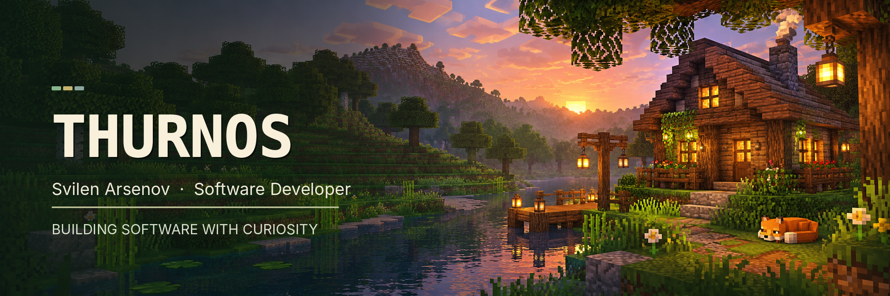

<!--
  Personal profile for github.com/Thurnos
  Keep assets/ alongside this README.md.
  The FreezeBg skin render is provided dynamically by MCHeads.
-->

  
   
  <h3>Backend &amp; Web Development · Software Engineering · Game Systems</h3>
  
Building thoughtful software, from web applications to the systems behind games.

## Hello there 🌿

I'm **Svilen**, also known as **Thurnos** — a developer based in Bulgaria with a focus on **backend engineering and web development**.

I enjoy designing applications that are reliable, well-structured, and satisfying to build. I'm also interested in **software architecture, algorithm design, simulations, and custom-engine development**, especially where different components need to work together.

Outside of traditional software projects, gaming is a big part of my life. **Minecraft** is a particular favorite: I love the possibilities of **Java server plugins, gameplay systems, progression mechanics, and modding**. It's an excellent place to explore engineering ideas in a creative environment.

 

## Technologies & tools

I work primarily with **Java and the Spring ecosystem**, while using other languages and tools across web, software, infrastructure, and game development.

**Programming languages**

  

`Java` · `Python` · `C++` · `C#` · `JavaScript` · `TypeScript` · `HTML` · `CSS` · `SQL` · `PL/SQL` · `Bash` · `PowerShell`

**Backend & web development**

  

`Spring Boot` · `Spring MVC` · `Spring Security` · `Spring Data JPA` · `Hibernate / JPA` · `REST APIs` · `Thymeleaf` · `React` · `Vite` · `Bootstrap` · `Maven` · `Gradle`

**Databases & persistence**

  

`MySQL` · `PostgreSQL` · `Microsoft SQL Server` · `Oracle Database` · `PL/SQL` · `Database Design` · `SQL Optimization` · `ORM`

**Infrastructure, DevOps & developer tools**

  

  

`Linux / Ubuntu` · `Git` · `GitHub` · `GitLab` · `GitHub Actions` · `CI/CD` · `Docker` · `Kubernetes` · `Azure` · `Azure App Service` · `Azure Monitor` · `Prometheus` · `Grafana` · `VirtualBox` · `IntelliJ IDEA` · `VS Code` · `Postman` · `Unity`

These include both technologies I've used in projects and areas I'm continuing to learn and explore.

## Beyond web development

**Minecraft & game development**  
Creating custom Minecraft server plugins with **Java** and the **Paper / Spigot / Bukkit** ecosystem; designing RPG mechanics, skills, economies, progression, and connected multiplayer systems. I'm also interested in Minecraft modding and game development with Unity.

**Algorithms & software systems**  
Exploring scheduling and control algorithms, simulation, optimization, system design, and the architecture of custom engines. I especially enjoy engineering challenges that connect many small parts into one coherent system.

**Infrastructure & automation**  
Learning more about Linux, cloud services, build pipelines, monitoring, and deployment — the tools that help applications run reliably beyond the IDE.

  
  
<i>Thanks for visiting. May your code compile and your worlds keep growing. 🌲</i>

