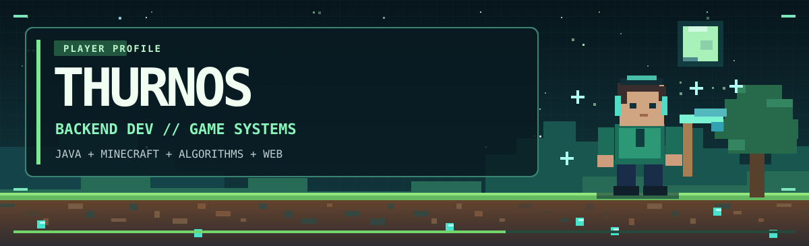
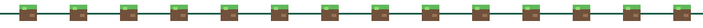

<!--
  THURNOS | Minecraft-inspired GitHub Profile
  Repo: https://github.com/Thurnos/Thurnos
  All assets in /assets must be committed together with this README.
-->

  

  

    
  

  

    
    
    
  

### 🟩 `player.info` — About me

Hey! I'm **Thurnos** — a developer and a lifelong gamer who loves turning ideas into actual systems. I enjoy **building web applications** (especially backend architecture), experimenting with **software development**, and figuring out how complex systems work under the hood.

- 🌐 **Main quest:** Web development, especially **Java / Spring Boot backend**, APIs, databases and full-stack applications.
- 🎮 **Favorite biome:** Gaming and **Minecraft** — developing **custom server plugins**, exploring **mod development**, and designing progression, economy, skills and gameplay mechanics.
- ⚙️ **Side quests:** Desktop/software projects, automation, **algorithm research**, simulations, system architecture and experimenting with **custom engines**.
- 🐍 **Also crafting with:** Python and C++ for scripting, tools and problem-solving.
- 🧪 **Currently exploring:** DevOps, Linux, containers, cloud infrastructure, monitoring and game systems.
- 📍 **Spawn point:** Bulgaria 🇧🇬

  

### 🧰 `inventory.open` — My tech stack

**Languages & fundamentals**

  

**Backend, frontend & frameworks**

  

`Spring Boot` · `Spring Security` · `Spring MVC` · `Hibernate` · `JPA` · `REST APIs` · `Thymeleaf` · `React` · `Vite` · `Bootstrap`

**Databases & SQL**

  

`MySQL` · `PostgreSQL` · `Microsoft SQL Server` · `Oracle Database` · `PL/SQL` · `SQL` · `Schema Design` · `ORM / JPA`

**Infrastructure, cloud & DevOps**

  

`Linux` · `Bash` · `Docker` · `Kubernetes` · `Azure App Service` · `Azure DevOps` · `CI/CD` · `GitHub Actions` · `Monitoring` · `Prometheus` · `Grafana`

**Tools, game development & experiments**

  

`IntelliJ IDEA` · `VS Code` · `Postman` · `Unity` · `Minecraft Paper / Bukkit / Spigot APIs` · `Fabric / Modding (exploring)` · `Game Systems` · `Custom Plugins`

> The inventory includes both tools I've worked with and technologies I'm actively exploring — not a claim that I've mastered every item.

  

### ⛏️ `quests.active` — What I build

| Quest | Description | Category |
| :--- | :--- | :--- |
| 🧱 **Minecraft plugin development** | Custom Java server plugins, player progression, RPG-style mechanics, PvP ideas, economies, and connected gameplay systems. | `Java` `Paper` `Game Systems` |
| 📚 **[Library Management System](https://github.com/Thurnos/Library-Management)** | Full-featured library management web application with business logic, persistence, security and multiple modules. | `Java` `Spring Boot` `MySQL` |
| ☕ **Coffee / Bakery POS** | Tablet-friendly point-of-sale platform with product catalog, order workflows, persisted sales and receipt printing. **In development.** | `Java` `Spring Boot` `React` `MySQL` |
| 🚚 **[Logistic Company](https://github.com/Thurnos/Logistic_Company)** | Backend and web-development project exploring business workflows. | `Java` `Spring Boot` |
| 🏠 **[House Manager](https://github.com/Thurnos/House-Manager)** | Software project exploring application structure and database persistence. | `Java` `Hibernate` |
| 🧠 **Algorithms & custom engines** | Exploring scheduling, simulation, optimization, complex system rules and engine architecture. | `Algorithms` `Systems` `Research` |

### 🎮 `dimension.minecraft` — Beyond the code

Minecraft is more than a game for me — it's a sandbox for experimenting with **software engineering**. I enjoy designing interconnected systems that create interesting gameplay: **custom Java plugins**, progression trees, classes, mechanics, automation and all the logic behind them. I'm also interested in the modding side of the Minecraft ecosystem.

I'm especially drawn to projects that grow into big engineering rabbit holes: simulation, algorithm design, custom engines, and making separate components work together reliably.

  

### 📊 `advancements.stats` — Player statistics

  
  

### 🐍 `world.tick` — Contribution snake

  

> The contribution snake appears after you run the included GitHub Actions workflow for the first time. Third-party statistics/typing services may occasionally be rate-limited or unavailable.

  
  
<b>Achievement unlocked:</b> <i>Never stop building.</i> 🏆

  

